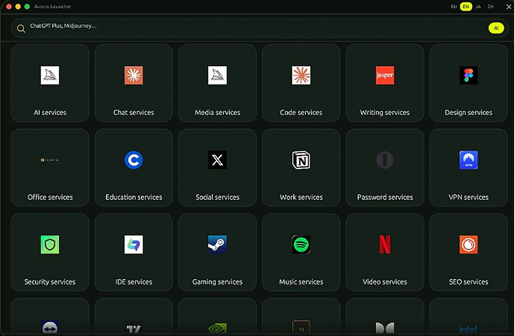

# Affinity Universal Free 2026 — Photo, Designer, Publisher in one license

> **Affinity is paid everywhere. In our Aivora launcher the same paid Universal version is free.**
>
> Official site / app store = paid Universal subscription. Aivora launcher = that paid Universal product, free on Windows 10 / 11.

**Keywords:** Affinity V2 Universal · Affinity free · Affinity windows · Photo Designer Publisher · paid Affinity free through launcher · Aivora Programs

Windows 10 / 11 · Affinity Universal · Design SaaS

The orange button opens [https://aivoraprograms.com/](https://aivoraprograms.com/). Install Aivora, then **Activate** **Affinity**. You get the **paid Universal** product **for free in our launcher**. No `Affinity.exe` in this repository.

## What Affinity is

Affinity V2 Universal is the paid Serif bundle: **Photo**, **Designer**, **Publisher**, Pro tools, updates, commercial use, offline. The Aivora card is **Universal**, not a single-app checkout. This is not Adobe Creative Cloud All Apps and not Canva Pro.

**Affinity is paid everywhere else.** Official access is a Universal subscription. In **our Aivora launcher** that same paid Universal is **free** on Windows 10 / 11. No vendor account. No credit card.

## Photo, Designer, Publisher in one license

Universal is three apps, not Photo alone. Offline is the desktop extra. After **Activate**, open Affinity from Design SaaS. This repo has no .afphoto file.

## Who this Windows page is for

Searches **Affinity**, **Affinity V2**, **Affinity windows** wanting **paid Universal**.

## What the Universal card includes

| Feature | Official Affinity | In our Aivora launcher |
|---------|--------------|------------------------|
| Price | Paid Universal subscription | **Free** (same paid Universal) |
| **Photo + Designer + Publisher** | Universal | Same paid Universal, free here |
| **Commercial use** | Universal | Same paid Universal, free here |
| **Offline desktop** | Universal | Same paid Universal, free here |

## How to open paid Affinity on Windows

1. Open [https://aivoraprograms.com/](https://aivoraprograms.com/)
2. Download **Aivora Launcher**
3. Install on **Windows 10** or **Windows 11** (64-bit)
4. Open **Design SaaS**
5. Find **Affinity** and press **Activate**

Paid Affinity Universal — **free in our launcher**, paid on the official site.

## Search queries this page covers

- **Affinity V2 Universal**
- **Affinity free**
- **Affinity windows**
- **Photo Designer Publisher**
- **paid Affinity free through launcher**

## Screenshots

Aivora launcher hub — **Design SaaS** → **Affinity**:

## FAQ

**Is this Creative Cloud?**  
No. Adobe Creative Cloud is a different Aivora card. This tile is Affinity V2 Universal.

**Where is the download?**  
[https://aivoraprograms.com/](https://aivoraprograms.com/)

**Is Affinity paid or free?**  
Paid everywhere (official Universal). **Free in our Aivora launcher** — same paid Universal version.

**Do I need a Affinity account?**  
No. **Activate** on the tile.

---

## На русском

# Affinity Universal бесплатно 2026 — Photo, Designer, Publisher в одной лицензии

> **Везде Affinity платный. В нашем лаунчере Aivora та же платная версия Universal — бесплатно.**
>
> Официальный сайт / магазин = платная подписка Universal. Лаунчер Aivora = этот же платный Universal, бесплатно на Windows 10 / 11.

**Ключевые слова:** Affinity V2 Universal · Affinity бесплатно · Affinity windows · Photo Designer Publisher · платный Affinity бесплатно через лаунчер · Aivora Programs

Оранжевая кнопка — главная Aivora. Лаунчер → **Дизайн SaaS** → **Affinity** → **Активировать**. Это **платный Universal**, у нас в лаунчере **бесплатно**.

Affinity V2 Universal — платный бандл Serif: **Photo**, **Designer**, **Publisher**, Pro-инструменты, обновления, коммерция, офлайн. Карточка Aivora — **Universal**, не одно приложение. Это не Adobe Creative Cloud и не Canva.

**Affinity везде платный.** Официально подписка Universal. **В нашем лаунчере Aivora** та же платная Universal-версия — **бесплатно** на Windows 10 / 11.

Universal — три приложения, не один Photo. Офлайн — десктоп. Файла .afphoto в git нет.

Запросы **Affinity**, **Affinity бесплатно** — нужен **платный Universal**.

| Функция | Официально | В нашем лаунчере Aivora |
|---------|------------|-------------------------|
| Цена | Платная подписка Universal | **Бесплатно** (тот же Universal) |
| **Photo + Designer + Publisher** | Universal | Та же платная Universal, у нас бесплатно |
| **Коммерческое использование** | Universal | Та же платная Universal, у нас бесплатно |
| **Офлайн на десктопе** | Universal | Та же платная Universal, у нас бесплатно |

Как открыть: [https://aivoraprograms.com/](https://aivoraprograms.com/) → лаунчер → **Дизайн SaaS** → **Affinity** → **Активировать**.

**Это Creative Cloud?**  
Нет. Adobe Creative Cloud — другая карточка. Здесь Affinity V2 Universal.

Affinity — товарный знак Serif (Europe) Ltd. Страница описывает доступ через Aivora Programs.

[https://aivoraprograms.com](https://aivoraprograms.com/) · hello@aivora.app

#windows11 #windows10 #affinity #design #aivora

---

*Affinity V2 Universal · Affinity free · Affinity windows · Photo Designer Publisher · paid Affinity free through launcher · Aivora Programs · paid Affinity free through launcher · Aivora Programs · https://aivoraprograms.com/programs/affinity-v2-universal/*
